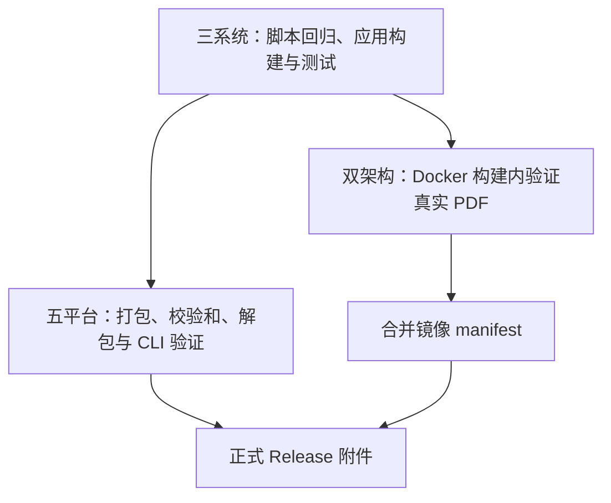

# CI 与发布

入口是 [GitHub Actions workflow](../.github/workflows/build-and-release.yml)。保留 main 自动更新 dev 镜像，以及五个平台的原生发布包验证。

## 流程



- **PR / 手动运行**：测试、打包和容器验证，保留 Actions artifacts，不对外发布。
- **push main**：同样执行检查，镜像验证通过后自动更新 `main`、`dev` 和完整 SHA 标签。包检查失败不阻止已验证的 dev 镜像发布；合并 job 仍会等待包矩阵结束。
- **Release**：所有测试、发布包和镜像均通过后，发布版本镜像及附件。只有正式版本更新 `latest`、主版本和次版本标签。

应用版本来自 csproj；Release 和手动选择 tag 时来自 tag。`scripts/ci.py version` 验证版本格式及 prerelease 标记。Docker 分支标签（例如 `main`）不参与程序集版本计算。

测试保留 `test (ubuntu-latest)` 等原有显示名称，避免改变已有分支保护所绑定的检查名。Linux 安装 TeX/Pygments/字体，要求全部测试实际执行；其他系统缺少 TeX 时明确跳过相关测试。

## 为什么这样简化

之前有独立准备 job，Docker 每个架构需要先构建加载到 daemon、启动容器验证，再调用一次构建导出。现在：

- 脚本回归与应用测试一起在三种系统执行，移除准备 job 和发布矩阵中重复的脚本回归。
- `dotnet test` 自动还原和构建，合并三个连续命令。[.NET 文档](https://learn.microsoft.com/en-us/dotnet/core/tools/dotnet-test)
- Dockerfile 的 `smoke` 阶段以 UID/GID 1000 验证 CLI、中文路径和真实 PDF；`final` 阶段挂载该阶段的 PDF，形成必须通过的构建依赖。测试文件不进入最终镜像。每个原生架构只调用一次 Buildx 构建并按 digest 导出。[BuildKit 挂载文档](https://docs.docker.com/reference/dockerfile/#run---mount)
- `scripts/ci.py` 使用 `shutil.make_archive` / `unpack_archive`，替代手写 Zip/tar 遍历；SHA-256 使用流式计算。stdout/stderr 分别转发，并保留 Windows UTF-8 处理。[Python 文档](https://docs.python.org/3.12/library/shutil.html#archiving-operations)
- 本地 `scripts/build.sh` 由 .NET SDK 识别 RID，调用同一归档实现，从 142 行减少到 42 行。打包无需安装 TeX，实际生成 PDF 时才需要。

双架构原生构建的 digest 传递和 manifest 合并继续保留：这是将两个 runner 的镜像组成一个多架构镜像的实际工作。改成单 runner + QEMU 可以少写部分配置，但会让 ARM64 的 TeX 安装和 PDF 编译经过模拟执行。[Docker 多平台文档](https://docs.docker.com/build/ci/github-actions/multi-platform/)

`uv` 擅长 Python 环境和依赖管理；这里的脚本只依赖标准库。`just` 能提供命令入口，但仍需实现发布步骤，因此这次没有增加这两项依赖。若以后需要 NuGet、deb/rpm 或 Homebrew 发布，可以考虑用声明式配置的 [dotnet-releaser](https://github.com/xoofx/dotnet-releaser) 替换更多发布逻辑；当前保留已有 .NET CLI / Buildx 和少量脚本。

## 本地运行

需要 .NET 9.0.3xx SDK 和 Python 3.12+：

```bash
python3 -m unittest discover -s tests/ci -v
dotnet test template_builder.sln -c Release -p:ContinuousIntegrationBuild=true
./scripts/build.sh
python3 scripts/ci.py verify linux-x64 --version 2.0.0-rc.1
docker build -t template-builder:local .
```

运行 verify 时替换为实际 RID 和版本。`APP_VERSION` 可覆盖本地构建版本。归档保留 `template_builder-<runtime>/` 顶层目录，Windows 使用 Zip，Unix 使用 tar.gz，旁边生成标准 `.sha256` 文件。

NuGet 和 Docker 构建缓存继续保留。同一分支的新 push / PR 取消旧运行，Release 不自动取消。测试上传 TRX，包验证失败保留诊断目录；容器测试的输出进入 BuildKit 日志和构建记录。默认仓库权限只读，发布相关 job 分别拥有所需写权限。

## 验证与已知边界

- 两轮旧日志已定位：最初失败来自错误的解包路径及将 `main` 用作程序集版本；第二轮仅 Windows 脚本的 cp1252 输出中文失败。版本、归档和编码回归均保留。
- 本次简化通过 595 项 .NET 测试（0 跳过）、9 项脚本回归、actionlint 1.7.12 和 Bash 语法检查；本地构建脚本完成 Linux x64 自包含发布与打包，新归档在强制 cp1252 环境下通过解包和 CLI 验证。
- 使用本机缓存的应用运行镜像，执行与正式 Dockerfile 相同的 `smoke` / `final` 阶段，确认普通用户生成 PDF、最终导出不包含测试文件。错误版本会阻止最终镜像导出。完整新镜像构建因 NuGet TLS 错误停止；其余平台与 ARM64 执行仍需 GitHub Actions 验证。
- 本地离线发布使用缓存的 .NET runtime/ILLink 9.0.20；临时覆盖仅位于 `/tmp`，未加入 CI 或生产配置。
- GHCR 与 GitHub Release 无跨系统原子提交保证；`release: published` 先创建页面，再通过门禁补齐附件，失败后可重跑。
- .NET 9 于 2026-11-10 结束支持，应另行迁移 .NET 10 LTS，并重新验收各平台。[Microsoft 支持策略](https://dotnet.microsoft.com/en-us/platform/support/policy)
