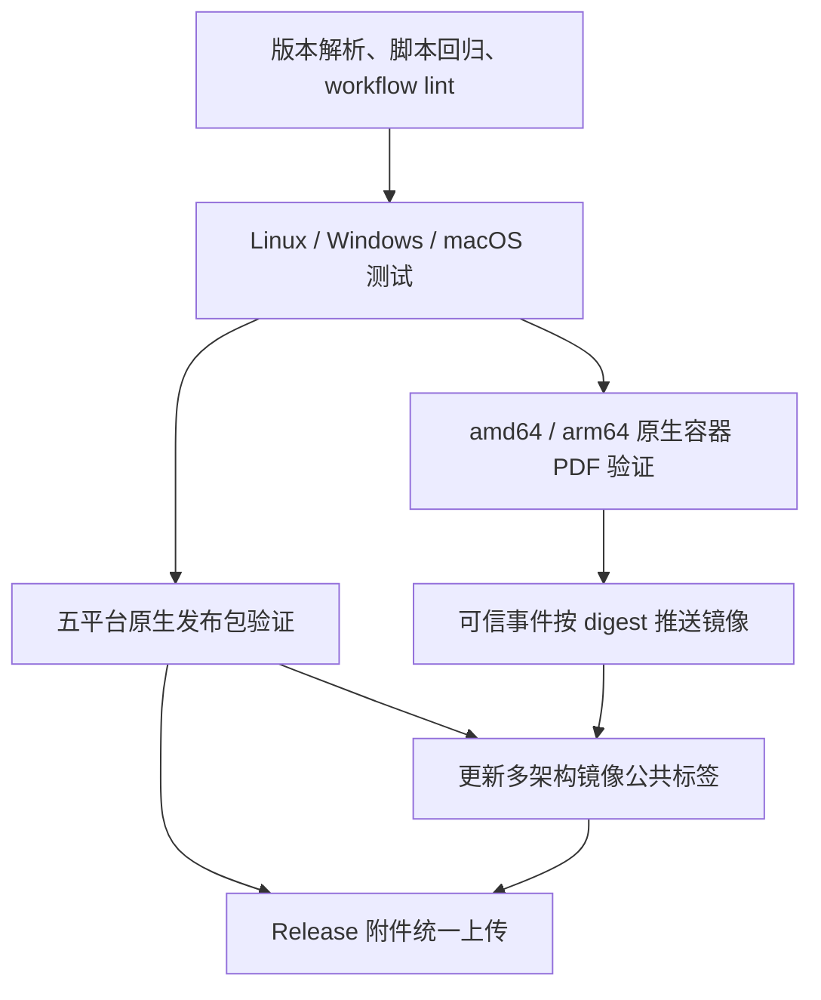

# CI 与发布流程

配置入口：[`build-and-release.yml`](../.github/workflows/build-and-release.yml)。版本解析、打包和 CLI 冒烟由 [`scripts/ci.py`](../scripts/ci.py) 共用，回归检查位于 [`tests/ci`](../tests/ci)。

## 失败原因与评估

2026-10-14 的 `temp/logs_104478720379.zip` 对应提交 `a07bf09`：

| 日志结果 | 原因与处理 |
| --- | --- |
| Linux 595/595；macOS、Windows 各 592 通过、3 跳过 | 应用单元测试通过；另外两个平台缺少 TeX，原流程的 PDF 端到端测试还会直接返回并被计为通过。现在使用明确的条件测试属性，Linux 要求 TRX 中全部测试实际执行。 |
| 四个 Unix 发布任务均报 `Binary not found` | tar.gz 保留了 `template_builder-<runtime>/` 目录，验证路径却遗漏该层目录。现在所有归档统一保留顶层目录，验证实际解包后的程序。 |
| Docker 报 `'main' is not a valid version string` | `docker/metadata-action` 的 version 是镜像标签候选，分支构建会得到 `main`。现在单独解析应用 SemVer，所有二进制和镜像使用同一输出。 |
| Windows 发布被取消 | 日志没有显示独立的 Windows 构建错误，不能把取消视为 Windows 缺陷。发布矩阵关闭 fail-fast，让后续运行保留各平台完整结果。 |

原流程具备三系统测试、严格编译告警、五种发布产物和多架构镜像，基本覆盖方向合理。但发布包只在合并后验证，Windows 外部命令失败可能被后续命令掩盖，镜像构建成功也不能证明运行依赖与 PDF 功能完整。

这些问题通过 PR 发布包门禁、统一跨平台验证器和容器真实 PDF 冒烟解决。Dockerfile 同时补齐 Ubuntu 24.04 的 ICU/OpenSSL 等 .NET 原生运行依赖，恢复 `/tmp` 的 sticky bit，并让容器构建读取与宿主构建相同的 `Directory.Build.props` 和 `global.json`。

## 门禁与触发策略



| 事件 | 应用版本 | 检查与产物 | 对外发布 |
| --- | --- | --- | --- |
| PR 到 main | csproj 的 Version | 完整测试、五个平台发布包、两架构容器 PDF；保留 Actions artifacts | 不推镜像、不写 Release |
| push 到 main | csproj 的 Version | 同上 | 所有门禁通过后更新 `main`、`dev`、完整 SHA 镜像标签 |
| 发布 Release | tag 去掉可选的 `v` 前缀 | 验证 SemVer 后执行完整检查 | 更新版本标签；正式版本额外更新主版本、次版本和 `latest`；全部检查通过后上传十个归档/校验附件 |
| 手动运行 | tag 使用 tag 版本，branch 使用 csproj 的 Version | 完整检查与 Actions artifacts | 不推镜像、不写 Release |

应用版本接受 `2.0.0`、`2.0.0-rc.1` 等 SemVer，不接受分支名、前导零或额外构建元数据。提交 SHA 由 .NET 的 InformationalVersion / Docker 构建参数携带。预发行 tag 必须在 GitHub Release 中标记为 prerelease，避免误更新 `latest`。

每个平台都原生执行解包后的自包含程序，不使用 QEMU、Rosetta 或 invariant globalization 绕过运行环境。检查包含 SHA-256、执行权限、`--version`、`--help`、嵌入配置与 Schema、JSON 校验协议及失败退出码。Docker 再验证普通用户、中文和带空格/方括号目录下的真实 PDF 生成。Windows Zip 现在也保留顶层目录，下载后应进入 `template_builder-win-x64/` 运行程序。

## 效率与可诊断性

- `global.json` 将 SDK 固定在 .NET 9.0.3xx 的最新补丁，避免 runner 预装新主版本后悄悄切换 SDK。
- NuGet 缓存按系统、架构和项目/SDK 配置区分；Docker 缓存按架构区分，避免同时写入同一缓存 scope。
- ARM64 Docker 使用原生 runner，消除 TeX 安装、font cache 和容器执行期间的 QEMU 开销。发布前第二次构建使用同一 BuildKit builder 的缓存，导出已验证镜像的 registry digest。
- 同一分支的新 push / PR 会取消旧运行；Release 运行不自动取消。发布包和 Docker 在测试完成后并行验证。
- 三系统测试保留原先 `test (ubuntu-latest)` 等显示名称，避免固定 runner 版本时改变已有分支保护所依赖的测试检查名。
- 所有 job 有超时；测试结果总是上传 TRX，包与镜像失败时上传配置、源码和隐藏构建目录中的诊断文件。
- 最终发布公共镜像标签依赖全部发布包和两架构镜像检查；GitHub Release 附件从已验证的 artifacts 集中上传。默认 token 只读，写权限仅出现在镜像和 Release 发布相关 job。
- Linux 的完整 TeX 测试仍保留；没有启用路径过滤或随意裁剪平台矩阵，避免漏检配置、资源和发布脚本改动。对应成本是 PR 也会执行完整打包和双架构镜像校验。

发布涉及 GHCR 与 GitHub Release 两个独立系统，无法做到跨系统原子提交；附件上传失败后可重跑失败 job。当前 `release: published` 触发器意味着 Release 页面先存在、附件随后通过门禁补齐。

长期维护还需安排 .NET 10 LTS 迁移：根据 [Microsoft 支持策略](https://dotnet.microsoft.com/en-us/platform/support/policy)，.NET 9 将在 2026-11-10 结束支持。本次修复保留现有 `net9.0` 目标框架，SDK、运行依赖和 Docker 基础镜像应在迁移时一起更新并重新验收五个平台。

## 本地验证

需要 .NET 9.0.3xx SDK 和 Python 3.12；真实 PDF 验证还需要 README 中列出的 TeX/Pygments/字体。CI 用官方 actionlint Docker 镜像 `1.7.12` 检查 workflow 语法、表达式及 shell 脚本。

```bash
python3 -m unittest discover -s tests/ci -v
dotnet restore template_builder.sln
dotnet build template_builder.sln -c Release --no-restore -p:ContinuousIntegrationBuild=true
dotnet test template_builder.sln -c Release --no-build --logger 'trx;LogFileName=tests.trx' --results-directory TestResults
dotnet publish template_builder.csproj -c Release -r linux-x64 --self-contained true -o publish/template_builder-linux-x64
python3 scripts/ci.py package linux-x64
python3 scripts/ci.py verify linux-x64 --version 2.0.0-rc.1
docker run --rm -v "$PWD:/repo:ro" --workdir /repo rhysd/actionlint:1.7.12
```

`--version` 应替换为本次实际构建版本。本地构建脚本移除了 publish 前的重复 build，从 csproj 读取默认版本，并用 `sha256sum` / `shasum` 兼容 Linux/macOS。

### 本次验证记录（2026-10-14）

- .NET SDK 9.0.319 下 Release 构建成功，0 warning / 0 error；595 项 .NET 测试全部通过，0 跳过。
- 8 项 CI 回归检查通过，覆盖分支/Release 版本、预发行标记、五平台归档路径、校验和损坏及外部命令退出码。
- 新构建的 Linux x64 自包含包通过打包、SHA-256、解包后 CLI 与 JSON 协议验证，且成功生成真实 PDF。
- 本地 NuGet 网络受限，发布验证使用缓存中的 9.0.20 runtime/ILLink 包，通过 `/tmp` 中临时 MSBuild 配置选择，生产 workflow 未加入该覆盖，也未禁用 NuGet audit。
- workflow YAML 与内嵌 Bash 语法检查通过；本地没有 Docker，actionlint 二进制下载超时，因此完整 actionlint、容器及其他系统/架构的执行留待 GitHub Actions。不能将本地结果等同于远端全矩阵通过。

设计依据：[GitHub runner 列表](https://docs.github.com/en/actions/reference/runners/github-hosted-runners)、[Docker metadata-action 的 version 输出](https://github.com/docker/metadata-action)、[Docker Buildx 导出参数](https://github.com/docker/build-push-action)、[Ubuntu .NET 原生依赖](https://learn.microsoft.com/en-us/dotnet/core/install/linux-ubuntu-install)、[actionlint 用法](https://github.com/rhysd/actionlint/blob/main/docs/usage.md)。

### 后续排查记录（2026-10-15）

`temp/logs_104567533680.zip`（提交 `3870ef0`）显示：actionlint、三系统 .NET 测试、四个 Unix 发布包，以及 amd64/arm64 容器的真实 PDF 验证均通过。唯一失败发生在 Windows 包的 `--help` 冒烟：Python 已按 UTF-8 解码子进程输出，却向默认 `cp1252` 的 stdout 打印中文，触发 `UnicodeEncodeError`。日志中的 Windows 可执行文件已成功输出版本号，不能据此认定应用自身启动失败。Windows 发布门禁失败后，公共镜像标签合并任务没有执行。

修复在 CI 脚本入口明确将 stdout/stderr 配置为 UTF-8，保留原始中文诊断内容和真实失败退出码。新增独立子进程回归检查，强制 `PYTHONIOENCODING=cp1252:strict` / `ascii:strict`、关闭 UTF-8 mode，验证帮助、初始化、JSON 校验和包含中文的失败诊断。该测试在修复前复现相同异常，修复后通过。

发布矩阵现会在五个原生平台上运行全部 CI 脚本回归检查；Unix 执行权限断言仅在支持 POSIX 权限的宿主上执行。9 项脚本回归在本地默认编码及强制 cp1252 环境下均通过；真实 Linux 自包含归档也在强制 cp1252 环境下通过校验、解包和 CLI 冒烟。Windows 本机结果及最终公共标签合并仍需由下一次 GitHub Actions 验证。
